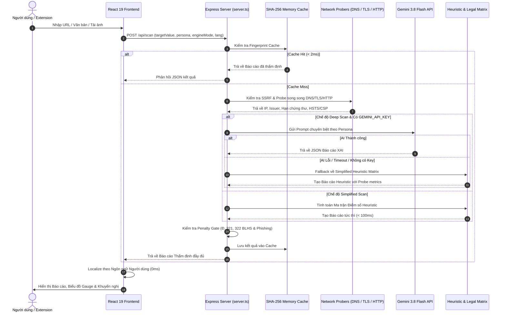

# 🏛️ Kiến trúc Kỹ thuật Hệ thống VerityTrust

## 1. Tổng quan Kiến trúc

VerityTrust được xây dựng theo mô hình **Thẩm định Kép (Dual Verification Architecture)**:
1. **Tầng Giao diện & Trải nghiệm (Presentation Layer):**
   - React 19 SPA được đóng gói qua Vite.
   - Styling bằng Tailwind CSS v4 kết hợp hoạt ảnh Canvas tùy biến và hiệu ứng HUD Telemetry.
   - Quản trị trạng thái và giao tiếp i18n phản hồi 0ms (`reportLocalizer.ts`).
2. **Tầng Máy chủ & Điều phối Thẩm định (Orchestration Layer):**
   - Express.js với bộ lọc bảo vệ SSRF (`isPrivateOrDisallowedHost`).
   - Probe hạ tầng mạng trực tiếp: `node:dns/promises`, `node:tls` X.509 handshake, và fetch HTTP headers.
   - Tầng lưu đệm in-memory giới hạn (LRU bounded cache) theo SHA-256 fingerprint.
3. **Tầng Trí tuệ Nhân tạo & Đối chiếu Pháp luật (Inference & Rule-based Engine):**
   - Mô hình Gemini 3.8 Flash (`@google/genai`) xử lý lý giải ngôn ngữ tự nhiên đa phương thức.
   - Thuật toán Heuristic Matrix tính toán song song, tự động fallback nếu ngắt kết nối API.
   - Ma trận chế tài hình sự và an ninh mạng (Penalty Gates).
4. **Tầng Tiện ích Mở rộng (Browser Integration Layer):**
   - Tiện ích mở rộng W3C Manifest V3 (Chrome, Edge, Brave) và Manifest V2 (Firefox).
   - Cơ chế đóng gói động bằng thư viện `JSZip` trực tiếp từ client.

---

## 2. Luồng Xử lý Dữ liệu Thẩm định (Data Flow Pipeline)

---

## 3. Thuật toán Tính điểm Tin cậy (Trust Score Formulation)

Điểm tin cậy cơ sở $\text{Score}_{\text{base}} \in [0, 100]$ được tính theo công thức:

$$\text{Score}_{\text{base}} = (S \times W_S) + (T \times W_T) + (L \times W_L)$$

Trong đó:
- $S$: Điểm An toàn Kỹ thuật (Safety Score, 0–100)
- $T$: Điểm Minh bạch Thông tin (Transparency Score, 0–100)
- $L$: Điểm Tuân thủ Pháp lý (Legality Score, 0–100)
- Trọng số tương ứng: $W_S = 0.40$, $W_T = 0.30$, $W_L = 0.30$.

### Cơ chế Khóa Phạt Cưỡng bức (Penalty Gate Mechanism)
Nếu phát hiện dấu hiệu vi phạm pháp luật hình sự nghiêm trọng:
- Vi phạm Điều 321, 322 Bộ luật Hình sự (Cờ bạc, cá độ trực tuyến trái phép):
  $$\text{Legality Score} = 0, \quad \text{Trust Score} \le 15, \quad \text{Status} = \text{"danger"}$$
- Bẫy đánh cắp thông tin đăng nhập hoặc mã OTP (Active Phishing / Credential Theft):
  $$\text{Safety Score} \le 12, \quad \text{Trust Score} \le 20, \quad \text{Status} = \text{"danger"}$$
- Tên miền không thể phân giải DNS (`NXDOMAIN` / `ENOTFOUND`):
  $$\text{Trust Score} \le 25, \quad \text{Status} = \text{"danger"}$$
