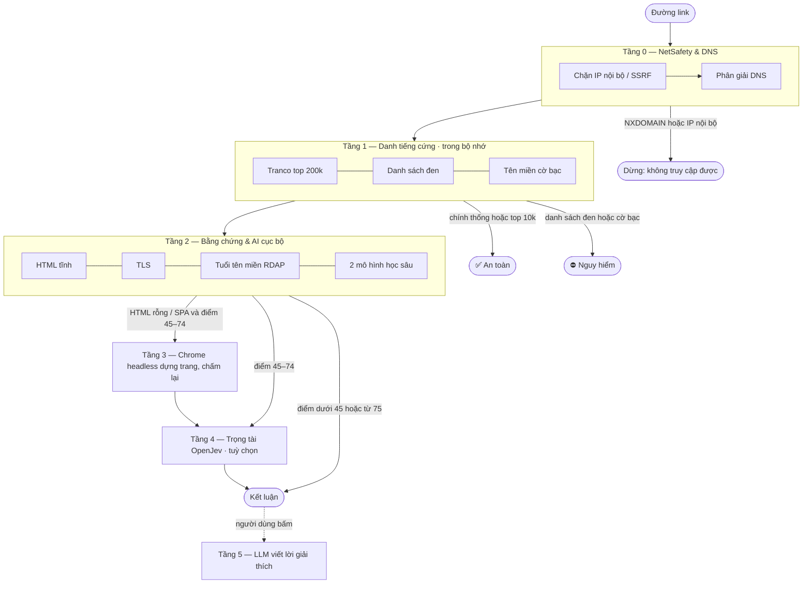

# Kiến trúc — đường ống quét nhiều tầng

[← Về README](../README.md)

Verity quét mỗi đường link qua tối đa **6 tầng**, sắp từ rẻ đến đắt. Ca nào đã đủ bằng chứng để kết luận thì **dừng sớm**, không chạy các tầng sau. Nhờ vậy web phổ biến (google.com, vietcombank.com.vn) có kết quả trong khoảng 0,2 giây, còn phần lớn thời gian xử lý dành cho các ca thật sự đáng ngờ.

Mã nguồn chính: [`server/scanPipeline.ts`](../server/scanPipeline.ts).



---

## Tầng 0 — NetSafety & phân giải DNS

**Mục đích:** không cho kẻ xấu lợi dụng máy chủ Verity để truy cập mạng nội bộ (tấn công SSRF), và loại ngay các tên miền không tồn tại.

- Từ chối mọi địa chỉ thuộc dải nội bộ hoặc đặc biệt: `127.0.0.0/8`, `10.0.0.0/8`, `192.168.0.0/16`, `169.254.0.0/16` (metadata đám mây), IPv6 nội bộ…
- Mỗi lần trang chuyển hướng (redirect) đều được kiểm tra lại DNS, tối đa 5 lần.
- **Dừng sớm khi:** tên miền không tồn tại (NXDOMAIN), hoặc tên miền công khai nhưng trỏ về IP nội bộ.

Mã: [`server/netSafety.ts`](../server/netSafety.ts), hàm `resolveTargetDns` trong [`server/evidence.ts`](../server/evidence.ts).

## Tầng 1 — Danh tiếng cứng (không tải trang)

**Mục đích:** trả lời ngay những ca hiển nhiên mà không cần tải HTML.

| Nguồn | Nội dung | Cập nhật |
|---|---|---|
| [Tranco](https://tranco-list.eu) | 200.000 tên miền phổ biến nhất thế giới | tải nền, lưu `.cache/` |
| Danh mục chính thống | ngân hàng, cơ quan nhà nước, sàn TMĐT lớn ([`domainRules.ts`](../server/domainRules.ts)) | trong mã |
| [Phishing.Database](https://github.com/Phishing-Database/Phishing.Database), [OpenPhish](https://openphish.com) | danh sách đen URL/tên miền lừa đảo | tải nền |
| Google Safe Browsing | tuỳ chọn, cần `GOOGLE_SAFE_BROWSING_API_KEY` | trực tuyến |
| Luật tên miền cờ bạc | `1xbet`, `fb88`, `nhacai`, `taixiu`… | trong mã |

- **Dừng "An toàn" khi:** tên miền thuộc danh mục chính thống, hoặc nằm trong top 10.000 Tranco. Subdomain người dùng tự tạo trên hosting miễn phí (`abc.vercel.app`, `xyz.github.io`…) không được hưởng ngoại lệ này.
- **Dừng "Nguy hiểm" khi:** có trong danh sách đen, hoặc là tên miền cờ bạc rõ ràng.

## Tầng 2 — Bằng chứng & AI cục bộ

**Mục đích:** thu thập mọi dấu vết kỹ thuật rồi chấm điểm theo bằng chứng. Đây là tầng làm việc chính.

1. **Tải HTML** qua `safeFetch`: tối đa 1 MB, hết thời gian sau 6 giây, không chạy JavaScript.
2. **Phân tích HTML** (`analyzeHtml`): ô mật khẩu, ô OTP/số thẻ/cụm từ khôi phục ví, form gửi dữ liệu sang tên miền khác, mã JavaScript bị làm rối, gửi dữ liệu qua Telegram bot, favicon của thương hiệu khác, thương hiệu được nhắc tới, logo Bộ Công Thương, mã số thuế…
3. **Chứng chỉ TLS:** còn hạn không, cấp bao lâu rồi.
4. **Tuổi tên miền** qua RDAP (tra trực tiếp registry theo bảng IANA).
5. **Hai mô hình học sâu** chạy cục bộ: một đọc tên miền, một đọc nội dung trang — xem [MO-HINH-AI.md](MO-HINH-AI.md).
6. **Chấm điểm** ([`riskScoring.ts`](../server/riskScoring.ts)) — xem [CHAM-DIEM.md](CHAM-DIEM.md).

- **Dừng khi:** điểm dưới 45 (rõ ràng nguy hiểm) hoặc từ 75 trở lên (rõ ràng an toàn).

## Tầng 3 — Trình duyệt headless (chỉ khi cần)

**Mục đích:** nhiều bộ công cụ lừa đảo chỉ vẽ form đăng nhập bằng JavaScript để né các bộ quét đọc HTML tĩnh. Tầng này dùng Chrome thật để dựng trang, lấy DOM cuối cùng, rồi chấm lại bằng logic của Tầng 2.

- **Chỉ chạy khi** HTML tĩnh gần như rỗng, là khung SPA hoặc trang chặn bot, **và** điểm còn ở vùng xám 45–74.
- Dùng Chrome/Chromium có sẵn trên máy qua `playwright-core` (không tải thêm trình duyệt). Không tìm thấy Chrome thì tầng này tự bỏ qua.
- **An toàn:**
  - Mỗi lần dựng dùng một phiên ẩn danh mới.
  - **Mọi request** của trình duyệt, kể cả request do JavaScript của trang tạo ra, đều qua bộ chặn SSRF.
  - Chặn ảnh, CSS, font, tải file, service worker và quyền truy cập thiết bị.
  - Tối đa 2 trang cùng lúc, mỗi trang tối đa 8 giây.

Mã: [`server/headless.ts`](../server/headless.ts). Cấu hình: `HEADLESS_RENDER`, `CHROME_PATH`, `HEADLESS_TIMEOUT_MS`, `HEADLESS_CONCURRENCY`.

## Tầng 4 — Trọng tài Jev / OpenJev (tuỳ chọn)

**Mục đích:** với ca vùng xám 45–74 điểm, hỏi thêm một hệ thống ra quyết định bên ngoài.

- Mặc định **tắt** (`JEV_MODE=off`).
- `JEV_MODE=api` dùng dịch vụ đám mây, `JEV_MODE=openjev` dùng bản tự host.
- Chỉ được điều chỉnh điểm trong giới hạn, không lật ngược các bằng chứng nghiêm trọng.

Mã: [`server/jevDecision.ts`](../server/jevDecision.ts).

## Tầng 5 — LLM viết lời giải thích (theo yêu cầu)

**Mục đích:** diễn giải kết quả bằng ngôn ngữ dễ hiểu cho người dùng phổ thông.

- **Không nằm trong đường chấm điểm:** AI không thể thay đổi điểm số.
- Chỉ chạy khi người dùng bấm "Xem giải thích chi tiết (AI)" → `POST /api/explain`.
- Dùng Gemini hoặc OpenRouter nếu có API key; không có key thì dùng bản giải thích soạn từ bảng bằng chứng.

---

## Theo dõi hành trình qua các tầng

Mỗi kết quả của `/api/analyze` có trường `pipeline` cho biết dừng ở tầng nào, vì sao, và mỗi tầng mất bao lâu:

```json
"pipeline": {
  "exit_tier": 1,
  "exit_reason": "Website phổ biến (Tranco #1.234)",
  "total_ms": 180,
  "rendered_by_headless": false,
  "tiers": [
    { "tier": 0, "name": "NetSafety & Phân giải DNS", "status": "passed", "ms": 160, "note": "Phân giải 1.2.3.4 (IP công khai)" },
    { "tier": 1, "name": "Danh tiếng cứng & Tên miền", "status": "exit", "ms": 1, "note": "Website phổ biến (Tranco #1.234)" },
    { "tier": 2, "name": "Bằng chứng & AI cục bộ", "status": "skipped", "ms": 0, "note": "Dừng sớm ở Tầng 1 - bỏ qua tải HTML" }
  ]
}
```

Giao diện web hiển thị phần này ở mục **"Các Tầng Quét"**.

## Các lớp bảo vệ an toàn

| Rủi ro | Biện pháp |
|---|---|
| SSRF: dùng Verity để gọi vào mạng nội bộ | Chặn IP nội bộ ở mọi bước: DNS ban đầu, từng redirect, từng request của trình duyệt headless |
| Trang độc hại làm treo máy chủ | Giới hạn 1 MB, 6 giây cho mỗi trang; 2 trình duyệt đồng thời, 8 giây mỗi trang |
| Chứng chỉ lỗi trên trang lừa đảo | Chỉ request **tải trang đích** chấp nhận chứng chỉ lỗi (để vẫn đọc được trang). Mọi kết nối khác, như gọi API AI, vẫn kiểm tra chứng chỉ đầy đủ |
| Lạm dụng API | Giới hạn tần suất theo IP (`RATE_LIMIT_PER_MIN`, mặc định 30/phút) |
| Trang mở hộp thoại, tải file, xin quyền | Headless tự đóng hộp thoại, chặn tải file, không cấp quyền nào |
